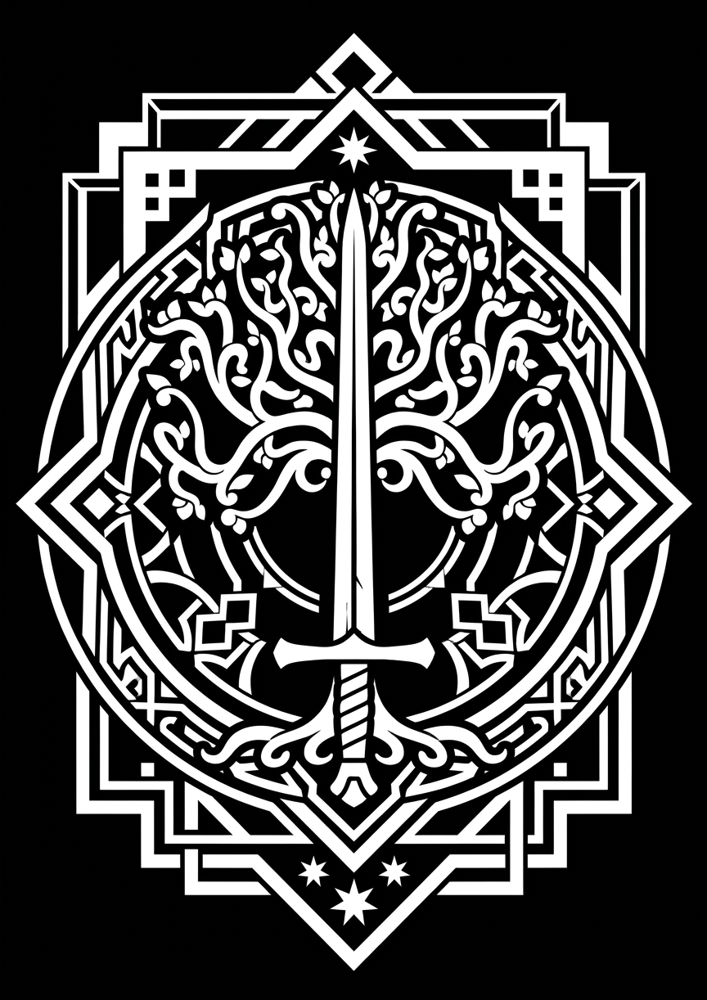

# Human Empire (Empire)

Status: `draft`

Mechanics and roster: [`../../FACTIONS.md`](../../FACTIONS.md) §2.

## Concept (from the mechanics)

A disciplined army and stone fortresses: heavy infantry, knights, archers and siege engines. The focus is on physical damage, formations and fortifications.

## Who they are

- **What they call themselves and what others call them:** > Concordia
- **Where they came from, how old they are as a people:** the unified Empire formed several centuries ago from the union of previously scattered tribes. Their differences have long since blurred; the tribal past is remembered mostly through stories and monuments to the generals who united them. > ❓ Under what circumstances did the unification happen?
- **Where they live** (see [`../geography.md`](../geography.md)): > ❓
- **How society works** (power, estates, faith): a monarchy headed by a king. Each city is led by its own ruling dynasty and is represented at court. Each of the five regional knightly orders has its own representative on the council; the Paladin Order, the mages and the Order of Builders are also represented on it. Healers are one of the branches of the priests, the light mages, and do not have a separate seat on the council. The council is an advisory body: the final word always rests with the king. The powers of the representatives and how they are appointed — > ❓
- **What they want in this war:** > ❓
- **Their "gray" side** (mixed tone): > ❓

The cultural reference is a medieval European country; it is not tied to any one specific historical culture.

The architecture of the Empire varies by region. Its central image is set by the capital, [Kordkayer](../geography.md), a city of two rings at the foot of a mountain.

Internal relations between the city dynasties are largely peaceful; whatever rivalry there may be between them does not define the life of the Empire.

For most inhabitants, the rule of their city's dynasty is a familiar and generally accepted order.

The Empire has no separate hereditary nobility: knights, paladins and mages count as nobles. The Order of Builders unites architects and builders and has its own representative on the royal council.

The paladins are united in an independent righteous religious order: it answers to the king, keeps its own structure and has a voice on the council at court. The order preaches kindness and justice, but also serves as the local inquisition. The specific religion, teaching and powers of the order have not been determined yet.

The mages of the Empire are scholars who study the concentrations of primal energy and try to control them. They have partly mastered fire, ice, lightning and light. Priests are mages who specialize in light magic; its nature is no different from that of the other schools of magic. The mages are led by the Archmage, who represents them on the royal council.

## Regional knightly orders

The knightly orders preserve echoes of the times when the lands of the future Empire belonged to different tribes. Each of the five major regions has its own order, whose traditions, arms and ways of waging war were shaped by local culture and conditions.

### Central Order

The main image of imperial knighthood and the king's personal mainstay: many of its knights serve at court as the monarch's bodyguards. They wear heavy armor, undergo drill training and keep strict discipline. In battle the order relies on heavy cavalry, the frontal charge and holding position. Its culture rests on hierarchy, ancient titles and solemn ceremonies of knighting.

**Appearance:** full heavy plate with even, severe lines; closed helmets, long cloaks and ceremonial surcoats over the armor. Their equipment looks uniform and ceremonial, and their weapons and shields emphasize formation and allegiance to the crown.

**Reference image:** `docs/lore/images/empire/orders/central-order.*`

### Western Order

Western knights value valor, personal honor and earned reputation. Their life is full of tournaments, duels, coats of arms and personal oaths; noble families compete for the right to bring glory to the order. On the battlefield this is decisive shock cavalry, ready to seek single combat with enemy heroes and turn the tide of battle with a bold charge.

**Appearance:** richly decorated plate armor, personal coats of arms on shields, caparisons and cloaks. Helmets and weapons are often adorned with house emblems or tournament keepsakes; the equipment deliberately differs from knight to knight.

**Reference image:** `docs/lore/images/empire/orders/western-order.*`

### Eastern Order

The order of the borderlands and open lands, where maneuver, endurance and military cunning are prized. Its commanders are independent and strive to force an unfavorable fight on the enemy rather than accept the enemy's terms. The knights operate as mobile forces: they scout, go around the flanks, pursue the retreating and exploit the enemy's mistakes.

**Appearance:** layered armor that does not restrict the seat and movement in the saddle, with short cloaks and practical helmets. Their equipment is lighter than the ceremonial plate of the Central and Western orders; reliability on a long road matters more in it than a solemn look.

**Reference image:** `docs/lore/images/empire/orders/eastern-order.*`

### Southern Order

The knights of the warm lands prefer speed, precision and freedom of movement. Heavy armor is exhausting here, so the order uses lighter equipment, open helmets and weapons that let them change distance quickly. In battle this is light and medium cavalry, able to attack swiftly, go around the flanks and withdraw before the enemy counterattacks. The order's culture highly values individual skill, flexibility, agility and composure.

**Appearance:** lightened armor of small movable plates and dense cloth, open helmets and loose cloaks that protect from sun and dust. The riders' silhouettes are built for speed: fewer bulky details, more flexible elements and light horse tack.

**Reference image:** `docs/lore/images/empire/orders/southern-order.*`

### Northern Order

The order of the harsh lands, where survival depends on mutual help and readiness to endure hardship. Its knights wear insulated heavy armor, choose reliable equipment and do not like to retreat. On the battlefield they act as protected cavalry, hold narrow passes and stand on the defensive. The order's traditions are built on harsh trials, collective responsibility and loyalty to one's word.

**Appearance:** heavy plate and mail over insulated clothing, closed helmets, thick cloaks and fur trim. Their weapons, shields and horse tack look massive and are made for cold, snow and long defense.

**Reference image:** `docs/lore/images/empire/orders/northern-order.*`

## Relations

| With whom | Attitude | Why |
|---|---|---|
| > ❓ | | |

## Questions

> ❓ What are the Empire and its capital called? How old is it?
> ❓ Who rules — the king (hero) with a court around him? Are there nobles, orders, a church?
> ❓ Where do the Empire's mages come from: a guild under the crown's supervision, free mages?
> ❓ What makes the Empire "gray": taxes, wars for land, pressure on its neighbors?

## Heroes

### Paladin

- **In game:** support warrior, light
- **Who he / she is:** > ❓
- **Background:** > ❓
- **Goal and weakness:** > ❓
- **Select / order line** (for voice-over): > ❓

### Archmage

- **In game:** elemental mage
- **Who he / she is:** > ❓
- **Background:** > ❓
- **Goal and weakness:** > ❓
- **Select / order line** (for voice-over): > ❓

### King

- **In game:** cavalry commander
- **Who he / she is:** > ❓
- **Background:** > ❓
- **Goal and weakness:** > ❓
- **Select / order line** (for voice-over): > ❓

## Units (lore for descriptions)

Roster: builders, swordsmen with shields, spearmen, archers, knights, ballistas, trebuchets, fire / water mages, lightning mages, healers.

| Unit | Who they are in the world (1–2 sentences for the in-game description) |
|---|---|
| > ❓ | |

## Buildings and architecture

Roster: keep, barracks, archery range, stables, workshop, mages' guild, forge, farm, walls and gatehouses, towers (archer, ballista, trebuchet), watchtower.

> ❓ What do their settlements look like: materials, shapes, colors. This is the reference for art ([`../../ASSETS.md`](../../ASSETS.md)).

## Visual style

- **Colors:** > ❓
- **Symbols and heraldry:** the common coat of arms of the Empire — [`imperial-coat-of-arms.jpg`](../images/empire/imperial-coat-of-arms.jpg); it unites the regional orders. The orders also have their own heraldry.
- **Reference images:** `docs/lore/images/empire/`

## Language and names

> ❓ What names sound like (5–10 examples), whether they have their own language or words.
