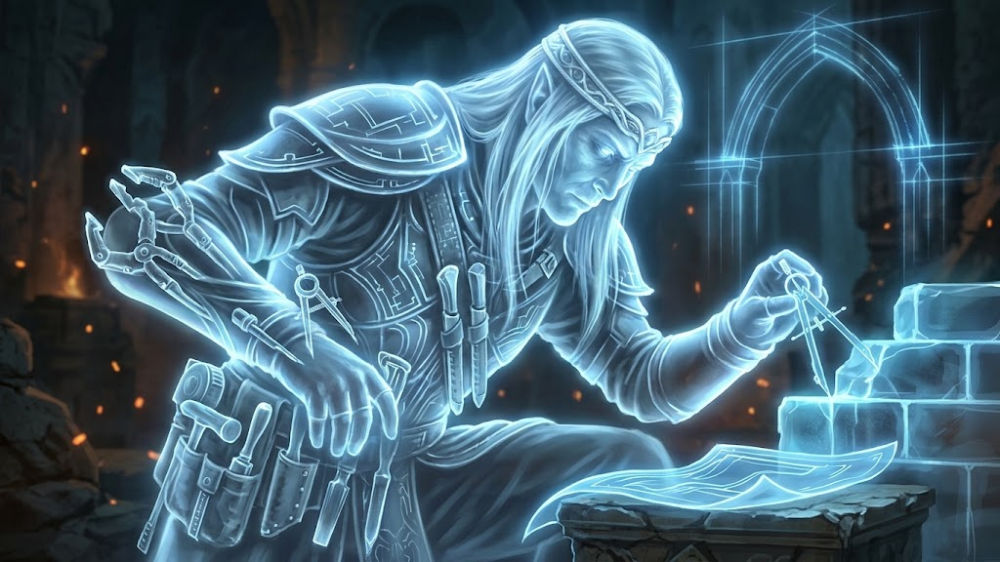

# High Elves

Status: `draft`

Mechanics and roster: [`../../FACTIONS.md`](../../FACTIONS.md) §3.

## Concept (from the mechanics)

An ancient people of the forests: the best archers, fast griffon and tiger riders, spirits and nature magic. They heal on their own land and see at night as well as by day.

## Who they are

- **What they call themselves and what others call them:** **Liénari**.
- **Where they came from, how old they are as a people:** one of the first civilizations of Oikouménē; took shape during the Age of Unification (about 500 years, see [`../history.md`](../history.md)).
- **Where they live** (see [`../geography.md`](../geography.md)): the capital Eldralinna, in a forest above the Strait, south of Rahupaxstad; the island of Merilinna in the Nimrath Sea, a stronghold on the sea routes; the military citadel Vaelralinna, on the rocky shore of the Strait in the west of the southern shore, guarding the sacred lake
- **How society works** (power, estates, faith): communities governed by a council of elders and keepers; see [Society](#society).
- **What they want at first contact:** > ❓
- **Their "gray" side** (mixed tone): see [Gray side](#gray-side) below.

## Society

The High Elves live in communities tied to ancient settlements, sacred groves and places where primordial energy is concentrated. Their society is built not so much around owning the land as around the duty to preserve it.

- **Elders** — the most respected members of the communities, responsible for traditions, settling disputes and passing on knowledge.
- **Keepers** — scholars, mages and experts in nature who study primordial energy, the history of the world and how living beings interact with their surroundings.
- **Warriors** — defenders of settlements, borders and sacred places. Military service is considered a duty to the people, not a path to personal glory.
- **Craftsmen and farmers** — full members of society. Making things is seen as an art, not only as producing necessary goods.

The High Elves do not have a king in the human sense. Their society is governed by a council of elders and keepers, where authority depends on knowledge, experience and merit.

At the same time, their long lives create an internal problem: elders can hold their seats for centuries, making it hard for young elves to gain access to power. So a society that considers itself wise and harmonious is not always just.

The **Elf King** is the head of this council.

## Healing on their own land

Primordial energy is present throughout the world, but its concentration and properties differ from place to place. The lands of the High Elves are places where natural energy is preserved in an especially pure and stable state. This is why the elves heal on their own land.

## Gray side

The High Elves consider themselves guardians of the natural world and its ancient wisdom. They preserve their forests, sacred places, and traditions with extraordinary dedication. However, their reverence for nature can make them unwilling to accept that the world must change. They oppose settlements, mining, and large-scale development near their lands, even when these are essential for neighboring peoples to survive and prosper. To the Elves, they are protecting a fragile world; to others, they are an ancient people claiming the right to decide how everyone else may live.

## Faith

**The Tradition of the Living World**: nature has its own order sustained by a balance of natural forces; no church — keepers of sacred groves, sages and elders. Full description: [`../religions.md`](../religions.md#high-elves--the-tradition-of-the-living-world).

## Relations

At the start of the game the peoples meet for the first time (first contact, see [`../history.md`](../history.md)): there are no established relations yet. Attitudes toward other peoples follow from the faith (see "Faith" above) and arise during the game.

## Questions

The High Elves and the Dark Elves are not related, despite their similarity (see [`../history.md`](../history.md)).

## Heroes

Heroes are titles, not specific characters. In the campaign each title will belong to different characters; in PvP heroes are simply units. Names, backgrounds and personal stories are not written in the lore.

### Elf Ranger

Archer and scout.

### Elf King

Stag rider, sacred trees. The head of the council of elders and keepers.

### Priestess

Healer and light mage.

## Units

Each unit has three regional skins: `eldralinna`, `vaelralinna`, `merilinna` (see [`../../ASSETS.md`](../../ASSETS.md), Regional skins). Concept art: [`../images/high-elves/units/`](../images/high-elves/units/).

### Spirit

The spirits of the Liénari are embodiments of magical energy, called to serve as guardians of elven settlements. They raise buildings, restore structures and help the settlement grow. Unlike ordinary workers, they use no tools: they shape structures by controlling natural energy.

**Appearance:** a translucent figure, a glowing core, flowing body lines and particles of light. The silhouette resembles an elf, but without ordinary clothing or physical armor.

> Temporary reference image: it must be replaced with the artist's concept art.

### Swordsman

An elite warrior with a double-bladed sword and a protective shield. Switches quickly between attack and defense, fights ordinary infantry effectively and can hold a position. His skill makes up for the lack of heavy armor.

**Appearance:** light armor, a double-bladed sword and an elegant shield with a plant ornament.

**Skin colors:** white — `vaelralinna`, green — `eldralinna`, blue — `merilinna`.

<!-- References for the artist (Pinterest):
https://it.pinterest.com/pin/485685141035659982/ — the double-bladed sword
https://it.pinterest.com/pin/820288519681702178/ — white — vaelralinna
https://it.pinterest.com/pin/595530750774538528/ — white — vaelralinna
https://it.pinterest.com/pin/896427500854348975/ — green — eldralinna
https://it.pinterest.com/pin/846887904964816927/ — green — eldralinna
https://it.pinterest.com/pin/1008876754060437394/ — blue — merilinna
https://it.pinterest.com/pin/550072542013210598/ — blue — merilinna
-->

### Archer

Liénari archers are trained to shoot with high precision and to coordinate their attacks with other units. They strike enemies at range and cover the advance of their allies. Especially dangerous to slow and lightly protected targets.

**Appearance:** a long curved bow, light armor, a quiver of slender arrows and details resembling leaves and branches. No heavy hoods and no massive armor.

<!-- References for the artist (Pinterest):
https://it.pinterest.com/pin/592856738491368480/
https://it.pinterest.com/pin/447826756755244683/
-->

### Tiger Rider

Riders on large tigers are mobile fighters able to strike the enemy swiftly and pursue retreating squads. They are especially effective against archers, mages and other targets that find it hard to defend against a sudden attack.

**Appearance:** a large tiger with striking stripes, light elven armor and a short spear or blades. Unlike heavy human knights, the focus here is on speed, leaps and maneuver.

<!-- References for the artist (Pinterest):
https://it.pinterest.com/pin/571464640210230613/
https://it.pinterest.com/pin/402790760437971538/
-->

### Griffon Rider

Griffon riders are a rare elite of the Liénari. Griffons let them cross the battlefield quickly, attack vulnerable squads and bypass ground fortifications. Their main advantages are mobility and the ability to strike from the air.

**Appearance:** a griffon with an eagle's head, powerful paws and large wings; the rider in lightened silver armor with blue-turquoise details. The gear emphasizes the bond between rider and animal rather than ordinary cavalry discipline.

<!-- References for the artist (Pinterest):
https://it.pinterest.com/pin/843721311481501454/
https://it.pinterest.com/pin/312859505372305533/
-->

### Fire Elemental

An embodiment of fire energy, called up to destroy enemies directly. The elemental attacks with bursts of flame, leaves burning patches and is especially dangerous to dense formations. It is not a living being in the usual sense and wears no real armor.

**Appearance:** a humanoid figure of flame with a bright energy core, light inner lines and tongues of fire instead of hair and cloak. The design must be magical, not demonic.

<!-- References for the artist (Pinterest):
https://it.pinterest.com/pin/751678994103933645/
https://it.pinterest.com/pin/388224430405165233/
-->

### Water Elemental

Controls streams of water, slows enemies and breaks up their formations. Can create water waves and protect allies with flowing magical barriers. Its strength lies in controlling space and supporting the army, not in heavy direct attacks.

**Appearance:** a translucent body of flowing water, turquoise energy lines, swirling streams and a crystalline core. The silhouette constantly changes while keeping a humanoid shape.

<!-- References for the artist (Pinterest):
https://it.pinterest.com/pin/178736678957241728/
https://it.pinterest.com/pin/577234877242921420/
-->

### Storm Elemental

The swiftest of the three elementals. Controls electrical discharges and gusts of wind, strikes priority targets and temporarily disrupts the enemy's actions. Especially effective against small groups and vulnerable units, but must not replace the fire elemental as the main source of area damage.

**Appearance:** a glowing core, an elongated figure of wind and electrical energy, arcs of lightning instead of limbs and bright bluish-white flashes.

<!-- References for the artist (Pinterest):
https://it.pinterest.com/pin/793478028112245582/
https://it.pinterest.com/pin/513903007496561136/
-->

## Buildings and architecture

Roster: see FACTIONS.md §3.

> ❓ What do their settlements look like: materials, shapes, colors. This is the reference for art ([`../../ASSETS.md`](../../ASSETS.md)).

## Visual style

- **Colors:** > ❓
- **Symbols and heraldry:** > ❓
- **Reference images:** `docs/lore/images/high-elves/`

## Language and names

> ❓ What names sound like (5–10 examples), whether they have their own language or words.
