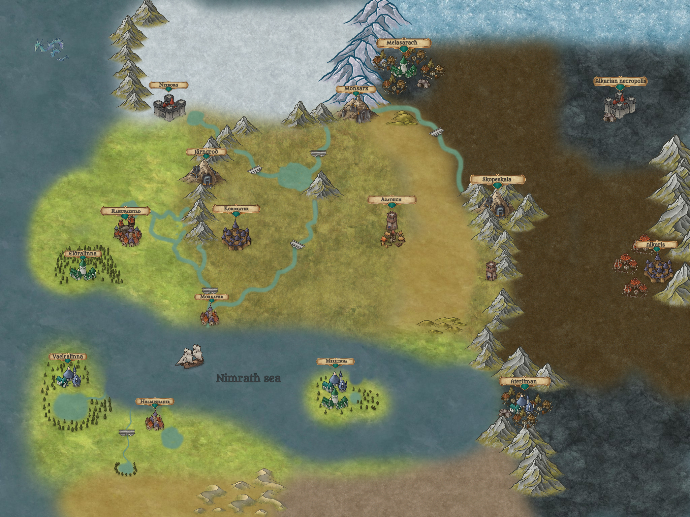

# Geography

Status: `draft`

## World Map

First sketch (to be expanded): [`images/world/world-map.png`](images/world/world-map.png).

What the sketch shows:
- **Northern continent — lands of the Empire:** green valleys in the west and center, dry steppes in the east. Cities: Nixborg (north, at the edge of the snows), Rahupaxstad (west), Kordkayer (center), Morkayer (southern coast, at the river mouth), Azatsich (east).
- **High Elves:** Eldralinna (forest south of Rahupaxstad, above the Strait), Vaelralinna (west of the southern coast, by the Strait, with the sacred lake), Merilinna (island in the Nimrath Sea).
- **Alkars:** Alkaris (east, beyond the ridge, with settlements of red tents), Alkarian Necropolis (northeast, in the stony lands).
- **Dark Elves:** Melasarach (northeast, by the icy sea, beyond the snowy mountains), Aterliman (southeast, in the coastal mountains).
- **Dwarves:** Monsarx (northern mountains, at the edge of the snows), Järngród (mountains northwest of Kordkayer), Skopeskala (eastern ridge — the border of the settled lands).
- **North:** snowy tundra and the icy sea.
- **East:** a mountain ridge separates the imperial steppes from the dark brown and stony lands.
- **Nimrath Sea** between the northern continent and the southern lands.
- **South:** the southern coast with Helmishahir, lakes, rivers flowing from oases, and desert beyond.

Unlabeled places:
- a lone tower by the eastern ridge — a human outpost, simply a watchtower;
- the sea serpent in the northwest is decorative and has no meaning in the lore.

## Regions

One region per people, plus contested lands where battles are fought (that is where the game maps will be).

### Lands of the Empire

- **Where:**
- **Nature and climate:**
- **Cities and fortresses:**
- **What they are rich in** (gold, wood, metal, food — game resources):

### Central Region — Kordkayer

**Kordkayer** is the capital of the Empire in the Central Region, a huge city at the foot of a mountain. From above it looks like two concentric rings behind the city walls. The city gets cold water from mountain springs through stone aqueducts; fountains and water jets have become an ordinary part of its gardens, squares and public buildings.

At the center lies the main square with a statue of an ancient king. Next to it are gardens with fountains, and beyond them the Great Council House. The building is made of pale stone, adorned with marble columns and tapestries depicting sessions of the Council and the deeds of past generations. Assemblies are held in its main hall; the side rooms are given over to archives, the councillors' work and state papers. The Council House is majestic but lacks palatial luxury: it is meant to express the continuity of generations and the unity of the Empire's lands, not the power of one man.

The emperor has his own manor — a modest ruler's house that serves as his personal residence. It is separate from the Council House: state and political decisions are discussed in the Council, while the final word remains with the monarch.

Nearby stands the Mages' Guild — a large domed building with four towers dedicated to fire, lightning, water and light. The Tower of Fire is faced with reddish stone, the Tower of Lightning has a pointed top and dark walls, the Tower of Water is built of pale stone with blue veins, and the Tower of Light stands out for its whiteness and clean lines. Under the dome are shared halls for research and the exchange of knowledge.

Next to the Mages' Guild is a cathedral surrounded by flowering gardens. Its pale walls are entwined with plants, and inside are frescoes, stained-glass windows, a fountain and a marble statue of a figure in prayer. It is the spiritual heart of the Holy Order: here paladins gather to pray, take their vows and seek guidance before dangerous campaigns.

Kordkayer's inner ring is wealthy and well kept: here stand the spacious houses of influential families long settled in the capital, prosperous merchants and people whose service or business is tied to the heart of the Empire. Their position is not a separate hereditary class status. The outer ring is more working-class: it holds forges, carpentry workshops, warehouses, the masons' complex and the Builders' Guild with its workshops, tool stores, drafting rooms and places for training apprentices. The military yards are there too — stables, barracks, armories and shooting ranges.

### Central Region — Morkayer, City on the Nimrath Sea

**Morkayer** is a large seaside city located where a wide river flows into the sea. The river runs through the whole city, dividing it in two, and serves as its most important trade artery. Along it, goods arrive in Morkayer from the Empire's inland territories, and from the city's port they are shipped by sea to distant lands.

On one side the city is protected by a mighty stone wall stretching across the land. On the other side its boundary is the sea itself. High walls and fortified towers guard the land approaches, while on the water side security is provided by the fleet, the harbor fortifications and the garrison.

Where the river meets the sea rises a huge lighthouse — one of the main symbols of Morkayer. Its light can be seen far out at sea and helps ships find a safe course to the river mouth. The lighthouse is not only a landmark for merchant vessels but also a lookout post from which an approaching fleet can be spotted.

#### City Layout

- **River trade route.** The river runs through the city, and its banks are reinforced with stone embankments. Along them are moorings for river boats, warehouses and trading yards. Bridges connect the two halves of the city, allowing movement between districts without hindering shipping.
- **Sea port.** Closer to the river mouth are large harbors for seagoing ships. Here goods from other countries are unloaded, ships are repaired and supplies for long voyages are stored. A separate part of the port is reserved for the navy.
- **Trade districts.** The busiest part of the city is concentrated along the river and near the harbors. Here are markets, inns, workshops, merchants' offices and warehouses. Thanks to its location, Morkayer links the Empire's inland regions with the sea trade routes.
- **Residential districts.** Away from the bustle of the port lie residential quarters, squares and public buildings. The closer to the center, the more spacious the houses and the richer their furnishings. The most prestigious part of the city is home to wealthy merchants, sea captains, officials and members of the imperial nobility.
- **Land fortifications.** A stone wall encloses the city on the landward side. Mighty gates control the roads leading to the capital, and towers allow watch over the surrounding plains and the coast. Along the wall are barracks, armories and areas for stationing defenders.
- **Great Lighthouse.** At the river mouth, right where it opens into the sea, stands a monumental stone tower. Its base may be part of a fortified complex that includes keepers' quarters, fuel stores, a signal platform and a small garrison. The lighthouse serves both as a navigational landmark and as a symbol of Morkayer's wealth and power.

#### Architectural Character

Unlike Kordkayer, Morkayer's look is defined not by the height of its buildings or the monumentality of its inner squares, but by long embankments, bridges, harbors and views opening onto the sea.

Suitable for the city are pale limestone, warm stone tones, red roof tiles and wide arcades along the trading streets. In the port districts the architecture is more utilitarian: massive warehouses, tall gates, hoisting machinery and wooden galleries. The wealthy districts can feature spacious inner courtyards, terraces and sea views.

The main architectural focal point is the lighthouse. It should be visible from almost any point on the waterfront and stand out against the city skyline. It can be made not just a tall tower but a true monument symbolizing the Empire's bond with the sea.

#### Image of the City

Morkayer is the Empire's gateway to the wider world. Goods, news, embassies and travelers from distant lands pass through it. If Kordkayer embodies the power and unity of the human lands, Morkayer represents their wealth, trade and connection with the outside world.

Its recognizable silhouette: stone walls on the horizon, a wide river amid dense buildings, ships' masts above the rooftops, and a tall lighthouse where the river meets the sea.

### Northern Lands — Nixborg, Northern Capital

**Nixborg** is the capital of the Empire's northern lands. It lies at the edge of the inhabited lands, not far from the cold sea. Unlike Morkayer, there are no convenient beaches or wide bays here: the coast is formed by high cliffs dropping straight into the sea. Access points to the water are few and hard to reach, so the city never became a major trading port.

The city is built amid a harsh stony landscape. Small green valleys sheltered from the wind by cliffs alternate with bare rocky slopes. Beyond the mountain ridges begins the endless northern tundra — a cold, almost treeless land where settlements are rare and winter lasts most of the year.

The northern capital stands on one such patch of habitable land, where the roads from the southern valleys and the northern border holdings meet. Thanks to its location it became the region's main administrative and military center.

#### Architecture and City Layout

- **Stone buildings.** The city is built mostly of dark gray stone quarried from the surrounding cliffs. The buildings have massive walls, small windows and heavy roofs designed for snow and strong wind. There are almost no decorative facades: the beauty of the architecture lies in its proportions, solidity and the skill of the masons.
- **Fortress walls.** On the side of the open valleys the city is protected by high walls with mighty square towers. Where natural cliffs form impassable barriers, no additional fortifications are needed. At the most vulnerable points are gates, watchtowers and fortified outposts.
- **Upper town.** On the highest part of the rocky ledge stands the citadel — the residence of the regional ruler and the seat of the military command. Next to it are the main administrative buildings, archives and the halls of the nobility. From here there is a view over the city, the valleys and the distant sea.
- **Lower town.** The residential quarters lie on ledges and in sheltered valleys. Narrow streets follow the natural terrain, linking squares, workshops and stone houses. In the most sheltered spots are small gardens and vegetable plots that provide the city with part of its food.
- **Military quarter.** The northern capital maintains large garrisons, weapon workshops, barracks and food stores. Here border troops are trained, squads are prepared to patrol the northern roads, and knights serving on the Empire's frontiers are received.
- **Quarries and craft workshops.** Outside the city wall, at the foot of the cliffs, are quarries where material for fortifications and public buildings is extracted. Blacksmiths, masons, carpenters and weaponsmiths work in the city. Their output is intended first of all for the needs of the region and its garrisons.

#### Character of the Northern Capital

The main impression of the city is impregnability, cold and age.

Dark stone, heavy towers and walls blend with the surrounding cliffs. In overcast weather the city seems a continuation of the mountain massif, and in fog its upper fortifications seem to dissolve into the clouds. Greenery appears only in sheltered valleys and inner courtyards, emphasizing the harshness of the surrounding nature.

At the same time, the northern capital should not look abandoned or poor. It is an important regional center with its own nobility, knightly orders, craft guilds and a rich history. Its wealth is expressed not in gold and luxury but in the scale of its fortifications, the quality of its stonework, and the city's ability to withstand long winters and military sieges.

### Western Lands — Rahupaxstad, Economic Capital

**Rahupaxstad** is a huge city in the western part of the Empire, spread across fertile plains along the banks of a great river. At the foot of ore-rich mountains and close to dense forests, it became the Empire's main center for producing, processing and trading resources.

This is not a city of tall towers and grand palaces. Its wealth is expressed in its size, its stores and its ceaseless work. Rahupaxstad covers a vast area, but most of its buildings remain low: stone houses, farmyards, workshops, warehouses and manors interspersed with gardens, vineyards and open grounds.

#### Character of the City

The city seems to merge with the surrounding lands. Pale stone, tiled roofs, wooden awnings and wide paved streets create the image of a warm, lived-in place. There is no strict division into a rich center and poor outskirts: residential quarters, workshops and farmland are found throughout the city, though individual districts have their own character.

Houses are surrounded by inner courtyards, workshops and small gardens. The estates of wealthy families occupy entire plots with outbuildings, vineyards and walled gardens. Between the districts you can find fields, orchards and pastures that gradually give way to the countryside beyond the city limits.

The city walls are relatively low and do not look like impregnable fortifications. They mark the city's boundaries and provide basic protection but do not define its appearance. Rahupaxstad's main strength lies not in its walls but in its people, production and resources.

#### Districts

- **River port.** One of the busiest districts in the city. Grain, timber, ore and goods from other regions arrive by river. Barges stand at the moorings, and warehouses, loading areas and trading yards stretch along the bank. Here ships are constantly being unloaded and wagon trains assembled to send goods on across the Empire.
- **Craft quarters.** Forges, carpentry shops, foundries, stonecutters, joiners and workshops making wagons and tools. Some workshops serve local needs; others fill orders for the army, builders and merchants. Many workshops have their own yards for storing materials and finished goods.
- **Warehouses and granaries.** Huge storage complexes belonging to merchants, landowners and the imperial administration. Grain, flour, metal, timber, stone and other goods are stored here. The size of these buildings underlines how important the region is for supplying the whole Empire.
- **Manors and vineyards.** The spacious estates of old noble families and wealthy landowners. Large houses stand side by side with barns, stables, wine cellars and outbuildings. Vineyards and orchards fill the plots between the estates and on the city's outskirts.
- **Arena and horse yards.** A large open arena serves as a venue for contests, festivals and public events. Nearby are stables, training grounds, forges and harness workshops. Here horses are trained, cavalry is prepared, and fairs are held that draw people from all over the region.

#### A City That Works

Life in Rahupaxstad is defined by the movement of resources. From early morning wagon trains roll into the streets, ships arrive at the port, furnaces are lit in the workshops and deals are struck at the markets. Ore and stone are brought from the mountains, logs from the forests, and grain, meat, vegetables and wine from the surrounding farms.

Yet Rahupaxstad does not look like an endless industrial zone. Its production is woven into everyday life: workshops sit next to houses, gardens next to warehouses, and spacious manors next to trading yards. It is a rich city, but its wealth is above all practical.

Rahupaxstad's defining feature is scale. It does not try to impress with the height of its buildings. It impresses with how much land it covers, how many goods pass through its port, how many workshops operate within its walls and how many people depend on its prosperity.

Compared with the Empire's other capitals, Rahupaxstad is its economic backbone: Kordkayer governs, Nixborg defends, and Rahupaxstad produces and supplies.

### Southern Lands — Helmishahir, Southern Capital

**Helmishahir** is the southern capital of the Empire, located on the opposite shore of the sea from Morkayer. It is the largest sea port of the southern lands and the main center of trade with overseas states.

The city stretches along the coast where a green strip of fertile land meets endless sands. Several rivers rising in distant oases cross the surroundings of the city, supplying it with water and allowing gardens, groves and farming settlements to exist amid the arid lands.

#### Port and Trade

Helmishahir's port occupies a large part of the coast. Long stone piers protected by breakwaters receive merchant ships from every corner of the known world. Timber, metal, weapons, cloth and grain are unloaded here, while spices, jewels, incense, crafted goods and wares brought by caravans from deep in the desert are shipped out in the other direction.

Along the harbor stretch huge warehouses, trading yards and caravanserais where merchants and travelers stop. Dozens of languages are heard in the markets, and the streets around the port are filled with porters, sailors, camel drivers and trade envoys from distant countries.

#### Architecture

Helmishahir is built mainly of pale stone, fired brick and clay. The city features massive walls, wide gates, arched passages and flat roofs, above which rise terraces, towers and domes.

In the wealthy quarters facades are decorated with colored glazed tiles, geometric ornaments and fine carving. The houses of wealthy merchants are hidden behind high walls that enclose shady gardens, fountains and inner courtyards. Narrow, shaded streets give way to spacious squares, and covered bazaars protect traders and buyers from the scorching sun.

Public buildings stand out with wide staircases, tall arches and richly decorated entrances. The rulers' palaces and the residences of influential trading houses are surrounded by gardens with pools and canals fed with water from the city reservoirs.

Helmishahir's architecture is adapted to the hot climate: thick walls keep the interiors cool, inner courtyards provide shade, and narrow streets shelter from the sun and hot winds. Here wealth is expressed not so much in the height of buildings as in their scale, decoration and thoughtful design.

#### Architecture and Districts

The city is characterized by flat roofs, domes, tall arches, massive gates and inner courtyards. Colored glazed tiles, geometric ornaments and fine carving adorn the richest buildings, while ordinary houses are simple and practical.

##### Port District

The port occupies an extensive stretch of the coast. Its look is defined by long stone piers, massive breakwaters, lighthouse towers and fortified harbors. Along the water stretch thick-walled warehouses with tall arched gates designed for moving large cargo. Between them are the offices of trading houses, shipwrights' workshops and spacious yards for storing goods.

Closer to the harbor the buildings are low and functional so as not to hinder loading and the movement of cargo. Above the port rise the towers of the customs house and the maritime administration.

##### Trading City

Around the port spread noisy trade quarters with covered bazaars, caravanserais and trading yards. Narrow streets run between buildings with arched galleries, and awnings are stretched over the passages to shield them from the sun.

The caravanserais are large rectangular complexes surrounded by high walls. Inside are a spacious courtyard for camels and wagons, storerooms, stables and rooms for visiting merchants. Each trade quarter has its own squares and fountains that serve as places to meet and exchange news.

##### Wealthy Quarters

The houses of wealthy merchants and influential families stand behind high stone walls. From the street they may look restrained, but inside open up spacious courtyards with pools, fountains, colonnades and gardens.

The interior rooms surround a central courtyard, which keeps the houses cool. The upper floors have shaded balconies and terraces, and the facades of the richest residences are decorated with carving, mosaics and colored tiles.

The streets here are wider and cleaner than in the trade quarters. The houses are separated from one another by walls, and small squares and gardens create quiet spaces away from the noise of the harbor.

##### Citadel and Palace District

On a height dominating the city and the port stands the citadel. It is surrounded by high walls with square towers and massive gates. Inside are the ruler's palace, barracks, armories, administrative buildings and water reservoirs.

The palace buildings feature large inner courtyards, monumental entrances and high halls with domed ceilings. Their facades are decorated with ornaments, colored ceramics and carved stone panels. From the citadel's terraces there is a view of the harbor, the city quarters and the desert beyond the green coastal strip.

##### Craft Quarters

Away from the busiest trading streets lie the craftsmen's quarters. Here stand dense rows of small houses and workshops with open work yards. Forges, pottery kilns, weaving workshops and dye works are grouped by trade.

The buildings are made of brick and clay, with small windows and flat roofs. In some places the upper floors overhang the streets, creating shade. Around the workshops are stores of raw materials and small markets where goods are sold straight from the makers' hands.

##### Residential Outskirts

Farther from the port and the wealthy quarters, the buildings become simpler. One- and two-story houses of clay and brick predominate here, with flat roofs, small inner courtyards and minimal outward decoration.

The streets form a dense web of narrow passages, small squares and dead ends. Houses often share walls, which helps keep them cool. Some quarters have public wells, small markets and fountains around which the residents' daily life is centered.

##### Gardens and Waterworks

Water defines not only the life but also the look of Helmishahir. Canals run through some districts, carrying water to reservoirs, fountains and public pools. In the wealthy quarters the canals become part of garden ensembles, while in the craft and residential districts they are used mainly for practical needs.

Beyond the city's buildings lie gardens, groves and fertile plots of land fed by the rivers that come from the oases. They form a green ring around the city that gradually gives way to dry plains and the endless desert.

#### The City and the Desert

Beyond the city the green lands gradually give way to sand. Oases with small settlements are connected by caravan roads along which goods from the heart of the continent reach Helmishahir.

Water here is valued no less than gold. Canals, reservoirs and underground conduits carry it to the city quarters, gardens and public fountains. Control over the springs and trade routes makes Helmishahir not only rich but also a strategically important city of the Empire.

#### Importance to the Empire

Helmishahir links the Empire with the world overseas. Rare goods, new knowledge and news from distant states arrive through its port. Here trade agreements are concluded, sea expeditions are fitted out and envoys of foreign rulers meet.

If Kordkayer is the heart of imperial power, Nixborg its northern shield and Rahupaxstad the source of its resources, then Helmishahir is its window onto the world beyond the sea.

### Eastern Lands — Azatsich, Capital of the Eastern Region

**Azatsich** is the capital of the Empire's eastern region, located amid endless steppes and prairies crossed by wide rivers and their tributaries. Unlike the stone cities of the central lands, Azatsich grew out of a fortified settlement of free nomadic peoples. Its wealth lies not in palaces and monumental temples but in vast pastures, numerous herds, mounted war bands and control over the trade routes across the steppe.

The city is surrounded by mighty wooden walls that shelter its permanent residents, traders and warriors. Beyond the walls stretches open land where nomadic clans set up seasonal camps, drive their livestock and gather for fairs. Azatsich is the place where the interests of many steppe communities meet and where the free peoples recognize the authority of the Empire while keeping much of their own customs.

#### Fortifications and City Layout

Azatsich's defining feature is its wooden fortifications. A high wall of thick logs surrounds the city, reinforced with earthen ramparts and watchtowers. In front of the walls wide open strips have been cleared so that an approaching enemy can be spotted from afar.

The city has several large gates through which caravans, riders and herds pass. In peacetime markets and inns operate near them; in times of danger the gates are closed and armed lookouts man the towers.

Inside, Azatsich does not resemble a city of regular stone quarters. Wide streets and squares sit alongside narrow passages between wooden houses, farmyards and workshops. The buildings are mostly one or two stories. Houses are built of wood, clay and stone, with stone used mainly for foundations, wells and the most important structures.

#### Districts

##### Central Square and the Rada

At the center of the city lies a large square where assemblies of elders, war leaders and representatives of the nomadic clans are held. Here decisions are announced, agreements concluded, disputes settled, and questions of war and peace discussed.

The main building on the square is the spacious wooden house of the Rada, with a wide porch, massive beams and a high gabled roof. Inside is a large hall where representatives of many communities can gather.

Nearby are the houses of the war leaders, the town administration and quarters for envoys. Power here is shown not by the height of palaces but by the ability to gather people, reach agreement with the clans and lead the cavalry.

##### Market Rows

Azatsich is the largest trading hub of the eastern steppes. Merchants come here from the central provinces of the Empire, the southern lands and distant countries. They bring cloth, weapons, metalwork, wine, jewelry and luxury goods, trading them for horses, livestock, leather, wool, grain and other goods of the steppe.

The market rows consist of wooden stalls, covered awnings and spacious yards. The largest deals are struck in the trading yards, where a whole herd of horses or a large flock can be driven in. On fair days the city's surroundings fill with temporary tents, wagons and hitching posts.

Here you can meet people of the most varied customs and origins. Its position on the steppe makes Azatsich a place for exchanging not only goods but also news, technologies and traditions.

##### Horse Yards and Military Quarters

Horses hold a special place in the life of Azatsich. The city has large horse yards where war horses and riding horses are bred, trained and sold. Separate grounds are set aside for races, riders' contests and military exercises.

The military quarters lie closer to the gates and fortifications. Here stand barracks, weapon workshops, equipment stores and stables for military squads. Most of the buildings are wooden, with spacious inner courtyards that can hold riders, horses and supply wagons at the same time.

The steppe army is not always in the city in full. A large part of the warriors live in nomadic camps and gather in Azatsich when summoned, during fairs or before a major campaign. This allows the city to receive large forces without turning into a permanent military camp.

##### Residential Quarters

The residential districts consist of wooden houses, clay-walled buildings and small homesteads with farmyards. Houses are often surrounded by low fences; in the yards people keep livestock, store wagons, dry hides and repair gear.

The streets here are wider than in the old trading cities, since riders and wagons need to pass. Between the quarters are wells, small squares, forges and shared awnings for craftsmen.

In Azatsich there is no strict division between the urban and the steppe way of life. Even behind the wooden walls the habits of the nomads endure: hospitality, the importance of the clan, respect for the horse and readiness to set out on the road at any moment.

#### Surroundings and Rivers

Rivers define life throughout the eastern region. Their banks are covered with meadows and fertile land, and the wide floodplains serve as pastures for numerous herds. Along the waterways lie small settlements, river crossings and seasonal camps.

Around Azatsich are large fairgrounds, horse pastures and places where the nomadic communities gather at certain times of the year. Away from the rivers the steppe gradually grows drier, and the roads disappear among the grassy plains.

The city itself stands at a convenient junction of overland routes and river crossings. Its importance is defined not only by its walls but by its ability to control movement across vast territories, where the distances between permanent settlements can be measured in days of travel.

#### Importance to the Empire

Azatsich is the Empire's eastern stronghold and the meeting place of the settled world with the free peoples of the steppe. Its inhabitants value personal freedom, martial valor and loyalty to their clan, so imperial authority here rests less on officials than on agreements with local leaders.

For the central government, Azatsich matters for its cavalry, its trade routes and the ability to muster forces on the eastern border. For the steppe peoples it remains a place of common assembly, trade and protection — a city that unites them without forcing them to give up their accustomed way of life.

If Kordkayer embodies imperial power, Nixborg the stern defense of the north, Rahupaxstad the productive might of the western lands and Helmishahir maritime trade, then Azatsich symbolizes freedom, cavalry and the boundless expanse of the steppes.

### High Elf Lands — Eldralinna, Capital of the High Elves

**Eldralinna** is the capital of the High Elves. The city stands in a forest above the Strait — on the map, south of Rahupaxstad, in the west of the continent, opposite Vaelralinna.

#### Architecture and Character of the City

The architecture of the High Elf capital is based on a harmonious union of stone, wood and living nature. The buildings do not push the forest aside but are woven into it: walls curve around mighty trunks, open galleries pass between branches, and the roots of ancient trees become part of foundations and stairways. Stone arches frame living crowns, bridges connect buildings with tree platforms, and balconies and terraces are buried in foliage. Even the grandest structures seem an extension of the surrounding landscape, as though the city had gradually grown out of the forest itself.

In the central part rise massive temples and shrines of pale stone. Their wide stairways, colonnades and high vaults emphasize the grandeur of elven civilization, yet even here the architecture is not separated from nature. Trees grow in the inner courtyards and through the open galleries, branches hang over the roofs, and roots cross the stone terraces. Sacred altars stand among ancient trunks, in glades and by springs, so the line between temple and natural sanctuary all but disappears.

Farther from the center the stone buildings thin out, giving way to houses built directly in and around the trees. Living quarters, platforms and small shrines are set on the huge trunks. A whole network of bridges, walkways and stairs stretches between the trees, connecting parts of the city with the forest. Some routes run high above the ground; others descend to streams and forest paths. This system continues far beyond the main quarters, turning the surrounding forest into a natural extension of the capital.

As a result, the city is not divided into a stone center and a forest periphery. Monumental temples, homes, bridges and ancient trees form a single space in which the grandeur of the architecture does not oppose nature but enhances it. The High Elf capital looks not like a city built in a forest, but like a city that grew together with it.

### High Elf Lands — Vaelralinna, Military Citadel

**Vaelralinna** is the main military fortress of the High Elves and the last outpost on the approaches to their realm. The city lies on the rocky shore of the Strait, amid dense forests that cover the coastal heights and stretch far inland (on the map — west of the southern coast, opposite Eldralinna). Unlike majestic Eldralinna, where architecture intertwines with nature and highlights the spiritual and cultural heritage of the people, this city was built above all for defense. Here beauty is subordinate to strength, and every structure serves a specific purpose.

#### Walls and Citadel

The citadel occupies high rocky terraces above the Strait. Huge stone walls follow the curves of the shore and the natural terrain, joining separate crags into a single defensive line. The massive fortifications are built of pale gray stone, and above them rise watchtowers, fighting platforms and fortified gates. At the most vulnerable points the walls form several successive lines, so that even breaching the outer defenses does not open the way to the heart of the city.

The main citadel stands on the highest part of the rocky promontory. Behind its inner walls are command halls, barracks, arsenals and supply stores. Here the elves' military leadership is based, defensive operations are planned and reserves are kept for protecting the surrounding lands. The inner courtyards are spacious enough for forming up troops, training and preparing squads for distant campaigns. Beneath the cliffs are additional chambers and storerooms, protected from bombardment and bad weather.

#### Lower Town

Below the citadel lie residential quarters, workshops and service buildings. The architecture here is sterner than in the capital: buildings have thick stone walls, narrow windows and sturdy roofs. The streets are laid out so that armed squads can move along them quickly, and the main crossroads and passages can be blocked off if needed. Forges, weapon workshops and equipment stores occupy separate parts of the city, supplying the fortress with everything it needs for a long siege.

#### Elven Traditions

Despite its military purpose, the citadel preserves elven architectural traditions. The stone arches are decorated with restrained carving, the towers have graceful proportions, and some buildings are set directly into the cliffs and the trees around them. The forest comes right up to the outer fortifications, but where needed for visibility and defense the ground has been cleared. From the high towers there is a view of the Strait, the opposite shore and the forest roads leading deep into the elven realm.

#### Sacred Lake

Near the city lies a sacred lake. It is hidden by a dense wall of trees and surrounded by thick vegetation, so it is almost impossible to find from outside. Only a few old paths, known to the keepers and chosen defenders, lead to the water. The lake's shores are almost unbuilt: among the trees one can find ancient altars, stone platforms for rites and small shrines. The water is considered sacred, and the lake itself is a place the elves guard from outsiders, admitting no casual visitors.

Right by the city, next to its outer fortifications, the lake is surrounded by dense ancient forest. Its dark waters lie among rocks and tall trees, forming a secluded place in the middle of a harsh defensive frontier. The forest comes down to the water itself, hiding most of the shoreline, and only a few narrow paths lead to the lake.

The city's buildings do not fully surround the lake. On the contrary, the elves deliberately left its shores untouched, preserving the forest thicket and the natural look of the place. Here and there among the trees can be seen ancient stone altars, steps leading down to the water and small shrines. Rites are performed here, old traditions are kept, and the keepers of the sacred place gather.

At the same time, the lake is under the protection of the citadel itself. Massive walls and watchtowers rise nearby, and guard posts control the approaches through the forest. The result is an unusual pairing: on one side, stern fortifications, barracks and military towers; on the other, still water, ancient trees and sacred altars.

Guarding the lake is among the duties of the citadel's garrison. Forest patrols watch the paths and crossings, and small fortified posts control the routes leading to the sacred place. In case of threat the city can shelter the defenders of the surrounding lands and become a base for counterattacks. Its position allows it at once to control the Strait, cover the approaches to the forests and keep enemy forces from advancing into the elves' inner lands.

The lake becomes the spiritual heart of the military citadel — a place the fortress protects on a par with its own walls. Even in a city built for war, it remains an untouched corner of ancient nature.

#### Image of the City

This citadel is the shield of the elven lands. Its huge walls and impregnable cliffs symbolize the military might of the people, while the sacred lake hidden in the forest is a reminder that the fortress protects not only territory but also ancient holy places. If Eldralinna embodies the soul and grandeur of elven civilization, Vaelralinna embodies its unbending will to defend its own world.

### Nimrath Sea — Merilinna, Island of the High Elves

**Merilinna** is a High Elf city on a wooded island in the Nimrath Sea. The city lies amid dense ancient forests that cover almost the entire island and serves as one of the elves' strongholds on the sea routes.

The island is surrounded by rocky shores, small coves and the clear water of the Nimrath Sea. Tall trees rise above the slopes, forming a dense green canopy. From afar Merilinna is almost impossible to make out: its buildings are hidden among the treetops, and its pale towers and bridges become visible only from certain points near the shore. On foggy days the island seems to dissolve into the sea haze, and sailors may pass close by without ever noticing the settlement.

#### Architecture

Merilinna's architecture is light and graceful. Buildings are made of pale stone and wood, and their forms follow the curves of branches and the natural lines of the rocks. Instead of massive walls, the city is protected by coastal cliffs, narrow passages between rocks and hidden fortifications. Bridges connect parts of the city, spanning ravines, streams and forest glades. Some buildings stand on the ground; others sit on natural terraces and high platforms between the trees.

#### City Layout

- **Island center.** The main part of the city — the place for assemblies, governance and the keeping of knowledge. Here stand the oldest and most majestic buildings, surrounded by huge trees that may have been growing since before the settlement was founded. The central squares are open glades framed by trunks and gardens, with paths radiating from them into the forest.
- **Harbors.** The harbors lie closer to the shore. They are set in sheltered coves where stone piers and wooden jetties fit into the natural terrain. Elven ships can approach the island without disturbing the quiet of the inner forests. Narrow paths and stairs lead from the shore to the city, and some routes are hidden among the rocks and vegetation. The harbors serve not only for trade and travel but also for watching the sea routes of the Nimrath Sea.
- **Residential districts.** They are scattered across the island in small clusters. Houses are surrounded by gardens, and between them patches of forest, streams and natural glades are preserved. Craft workshops are located separately, in places where their work does not disturb the peace of the city. The elves use timber and stone, trying not to spoil the look of the island and to preserve old trees even where new buildings go up around them.

#### Defense

Merilinna's defense rests above all on its location. Approaches from the sea are limited by cliffs and dangerous shallows, and the harbors are watched by guard towers. The forest hides the inner roads and lets the defenders move around the island unseen by the enemy. Knowledge of the local currents, coves and underwater obstacles makes it hard for a foreign army to land.

#### Image of the City

Merilinna is not just a settlement on an island, but a city that grew inside an ancient forest and faces the open expanse of the Nimrath Sea. To outsiders it seems quiet and almost defenseless, hidden among trees and mists. But its natural fortifications, hidden harbors and knowledge of the sea make the island a reliable refuge and an important elven stronghold.

### Forests of the High Elves

Dense forests that bear the same names as the elven cities.

- **Where:** the capital Eldralinna — in the forest above the Strait, south of Rahupaxstad; the island of Merilinna in the Nimrath Sea; the military citadel Vaelralinna — on the rocky shore of the Strait, west of the southern coast, with the sacred lake.
- **Sacred trees** ("own land" mechanic, healing — [`../FACTIONS.md`](../FACTIONS.md) §3):

### Dark Elf Lands — Melasarach, Religious Center

**Melasarach** is the greatest religious center of the dark elves, a vast underground city built deep inside a gigantic natural cavern (on the map: the northeast, by the icy sea, beyond the snowy mountains of Monsarx). The main temple of the Great Spider stands here, and its faith shapes not only the spiritual life of the drow but the structure of their entire society.

The city fills the space between massive stone walls that rise high toward the cavern vaults. Its buildings grow out of the rock, occupy natural ledges, and are linked by bridges, stairways, and galleries. Deeper in, new levels of the city open up, descending underground and vanishing into the darkness of side passages.

Melasarach has no need of sunlight. It is lit by huge colonies of luminescent fungi growing on the cavern walls, along the roads, and on stone terraces. Their cold bluish, violet, and greenish glow reflects off the dark stone, making it feel as if the whole city lies inside a living underground world.

#### Temple of the Great Spider

At the very center of Melasarach rises the temple of the Great Spider, the largest and most sacred structure in the city. It is built into a massive rock and climbs in several tiers connected by stairways, bridges, and narrow walkways over deep chasms.

The temple's architecture resembles a gigantic web. Stone arches spread out from the central sanctuary like a spider's legs, slender bridges span the voids, and carved columns intertwine like strands of web. Deep within the complex lie altars, ritual halls, priestess sanctuaries, and sealed chambers accessible only to the highest servants of the cult.

Above the main sanctuary towers an enormous spider statue carved from black stone. Its silhouette is visible from many districts of the city and serves as a constant reminder of the Great Spider's power.

The temple is more than a religious building. Decisions made here can change the fate of entire houses. The high priestesses set religious policy, bless military campaigns, and take part in the struggle for power between the aristocratic families.

#### City of the Great Hierarchy

The layout of Melasarach mirrors the social order of the drow. The closer a building stands to the temple, the higher its owners' status, the richer its architecture, and the greater their political influence. This rule defines the look of every district.

##### Inner City — Domains of the Great Houses

Around the temple stand the palaces of the most powerful aristocratic families. Their buildings are marked by tall towers, carved facades, graceful arches, and spacious terraces. The inner halls are adorned with rare minerals, precious metals, and magical lamps.

The palaces are linked by protected galleries and bridges. Inside are private sanctuaries, reception halls, libraries, treasuries, and rooms for secret meetings. Each house strives to display its might without outshining the temple and its servants.

##### Middle City — Merchants, Artisans, and Servants of the Cult

Farther from the temple lie the quarters of prosperous merchants, mages, artisans, and soldiers. Here stand multistory stone houses, workshops, markets, warehouses, and small shrines.

The streets bustle with carts, porters, and caravans from the depths of the Underdark. Weapons, armor, jewelry, and magical items are made here, and the trade in rare fungi, minerals, and underground creatures brings the city a large share of its wealth.

##### Outer City — Working Quarters and Lower Levels

On the outskirts lie simpler dwellings, common barracks, utility buildings, and resource extraction areas. The houses here are more crowded, the passages narrower, and the natural light of the fungi scarcer.

The deep levels hold large caverns where edible fungi are grown, underground animals are kept, and materials are mined. Here live workers, servants, and those who have no house of their own or the patronage of a powerful family.

#### Caves and Life Underground

Melasarach is not limited to the buildings of the central cavern. Around it lies a whole network of natural hollows, tunnels, and underground lakes, gradually incorporated into the city's infrastructure.

- **Fungus gardens** feed the city and serve as a source of light. Some varieties of fungi are grown solely to light streets and halls.
- **Spider caves** lie in closed districts where priestesses and dedicated servants keep the spiders used in religious rites and to guard the sanctuaries.
- **Underground markets** connect the city with other drow settlements and the trade routes of the Underdark.
- **Water reservoirs and underground springs** supply the inhabitants with water, and natural differences in elevation are used to distribute it among the districts.
- **Hidden tunnels** connect palaces, temples, and military posts. Some of these routes are known only to certain houses and are used for secret movement.

#### Power: Matriarchy and the Cult

Here matriarchy is upheld by religious tradition. Women head the noble houses, and the most influential of them hold the highest offices in the cult of the Great Spider; at its head stands the high priestess, the Spider Queen. Priestesses wield not only spiritual authority but political power as well.

#### The Atmosphere of Melasarach

Melasarach is at once beautiful and hostile. Strands of web hang from the dark vaults above; fungus gardens shimmer in the distance; bridges stretch over chasms toward black towers. At the heart of the city shines the temple of the Great Spider, surrounded by the palaces of those who hold the most power.

Here every inhabitant's standing is evident from where they live, their clothing, the symbols of their house, and their right to pass through certain gates. Even the architecture is a reminder of the social hierarchy: the higher the owner's status, the closer their house is to the temple and the more space, light, and ornament they are allowed.

### Dark Elf Lands — Aterliman, Underground Port

**Aterliman** is the underground port of the dark elves (on the map: the southeast, in the coastal mountains by the Nimrath Sea).

#### Location and Lighting

Aterliman lies in the coastal part of a mountain massif, but far below the surface. A natural passage connects the underground cavity with the sea, letting seawater reach deep beneath the mountains and form a sheltered harbor.

The city is never lit by the sun. Its streets, bridges, and buildings are lit by colonies of luminescent fungi growing on the rocks, walls, and cavern vaults. Their soft blue, turquoise, and violet glow reflects in the seawater and lights up the piers and terraces.

The farther from the harbor and the main streets, the dimmer the light. The old tunnels and lower levels contain almost completely dark stretches that the fungal light barely reaches.

#### A City by the Underground Sea

- **Harbor** — stone piers, warehouses, trading houses, and shipyards line the underground shore. The sea passage is guarded by fortifications.
- **Trade quarters** — markets, workshops, and the residences of merchant houses lie near the port, ensuring a constant flow of goods with the outside world.
- **Upper terraces** — the palaces of the aristocracy, mage towers, libraries, and council buildings are built into the walls of the enormous cavern.
- **Lower city** — residential quarters, barracks, production halls, and old tunnels reach deeper into the mountain massif.
- **Fungus gardens** — dedicated underground farms supply the city with food and with material for lighting.

#### Character of the City

Aterliman remains a dark elf society: it has noble houses, political intrigue, magic, and a strict social hierarchy. However, power belongs not to religious orders but to a council of aristocratic families.

The city stays neutral, since its wealth depends on trade and independence. It does not seek to spread the faith of the Great Spider and does not consider religious service a prerequisite for high standing.

#### Power: Matriarchy Without the Cult

Here, too, women head the noble houses and shape the city's political life. However, their power rests primarily on inheritance, wealth, control of trade, and influence on the council.

A woman need not be a priestess to hold high standing. She can become the head of a trading house, a magical researcher, a diplomat, or a military commander. Religious offices exist, but they grant no automatic advantage in politics.

The key difference: Aterliman does not reject matriarchy — it simply does not tie women's power to religion. In both cities women stand at the top of the social hierarchy, but the reasons for this system and the ways it is maintained differ.

#### Image of the City

A vast underground port surrounded by black cliffs and multilevel architecture, where thousands of luminescent fungi are reflected in the dark seawater. There is no sunlight here — it remains far beyond the mountain labyrinth.

### Dark Elf Lands — Overview

- **Where:** Melasarach (northeast) and Aterliman (southeast) are underground cities; there are no other drow settlements
- **Nature:** caves, underground lakes and seas, fungus gardens, webs

### Alkar Lands — Alkaris, City of the Alkars

**Alkaris** is the city of the Alkars (see [`factions/alkars.md`](factions/alkars.md)); on the map it lies in the east, beyond the mountain ridge, among the dark lands. Around it are settlements with red tents — orc camps without names.

- **Outer belt — fortress.** Massive walls of dark volcanic stone, black metal elements, angular towers, mighty buttresses, and jagged silhouettes. The architecture here is almost devoid of ornament: its purpose is to inspire dread and emphasize that the city is impregnable.
- **Inner city — rich Gothic.** Behind the fortifications lie palaces, aristocratic residences, squares, and grand public buildings. At the center of the city is based the order of mages led by the Dark Mage; the order keeps the knowledge of how orcs are created. Dark stone is combined with costly finishes, graceful arches, stained glass, metal ornament, and the rich clothing of the inhabitants.

The contrast is deliberate: from the outside the city looks like an instrument of war, and on the inside like a display of the elite's superiority.

### Alkar Lands — Alkarian Necropolis

This is not a full second city populated by the dead, but a vast necropolis watched over by a single warden (on the map: the northeast, in the stony lands). It can be pictured as a separate space far from the rich city:

- rows of ancient burials and massive mausoleums;
- stone paths, gates, and fences;
- old sections gradually swallowed by decay;
- individual monumental tombs among a multitude of simpler graves;
- the dwelling or post of the warden who is responsible for the entire necropolis. The warden is the Wraith King (an Alkar hero), who has himself already become one of the dead.

What is especially striking is that a rich and active civilization exists next to a place that almost never changes. The main city constantly displays power, beauty, and status, while the necropolis keeps the traces of those who no longer take part in that life.

### Dwarven Mountain Realm — Monsarx, Ancient Capital in the Northern Mountains

**Monsarx** is the greatest of the dwarven cities, an ancient capital carved into the heart of the highest massif of the northern mountains. Its architecture is shaped less by the mountain's surface than by its inner space: colossal halls rise dozens of levels high, stone palaces grow out of rock ledges, and stairways, bridges, and galleries connect entire districts reaching deep into the mountain and up toward its heights.

It is not merely the residence of the dwarven rulers but also the center of their engineering thought, craft, and runic art. The most intricate mechanisms are built here, new technologies are tested, and knowledge that other peoples consider lost is preserved.

#### Royal Halls

Deep within Monsarx lie the royal halls, a vast complex of ceremonial chambers intended for the rulers, the nobility, and gatherings of the dwarven clans. Towering columns support vaults covered in carvings of ancient kings, great battles, and the deeds of legendary masters.

In the central throne room a stone dais rises with a throne forged of metal and adorned with the runes of the ruling dynasty. Rows of columns stretch along both sides, and the coats of arms of the oldest families are carved into the walls. Here ambassadors are received, treaties between clans are concluded, and the fate of the underground domains is decided.

Beyond the ceremonial halls lie the private chambers of the royal family, treasuries, archives, and rooms for advisers. Unlike the working quarters, here the stone is carefully polished, the metal elements are covered in fine engraving, and light reflects off bronze and gold ornaments.

#### Great Workshops

Monsarx is famous for workshops whose scale exceeds entire craft quarters of other cities. They occupy separate halls inside the mountain, connected by freight tunnels, lifts, and wide stone passages.

Here work smiths, mechanics, stonecutters, founders, engineers, and makers of complex devices. Some workshops specialize in weapons and armor, others in construction machinery, lifting systems, clockwork devices, gates, and heavy machines.

In some halls, structures are assembled that are so large that moving them requires rail platforms, chain hoists, and whole crews of workers. High ceilings allow mechanisms to be set up vertically, and open multilevel platforms make it possible to work on different parts of a single device at the same time.

In Monsarx not only skill but also inventiveness is valued. There are separate rooms for experiments, where new mechanisms are tested before being sent into production. Failed designs are taken apart, studied, and used for the next experiments.

#### Foundry and Metallurgy Halls

The foundries of Monsarx are among the hottest and noisiest places in the city. They are huge stone chambers where ore is turned into metal, and metal into blanks for weapons, armor, tools, and mechanisms.

At the center of the halls stand large furnaces surrounded by work platforms and air supply systems. Molten metal flows along fireproof channels to the molds, and massive cranes and winches move heavy ingots. Deeper inside are separate rooms for refining ore, preparing alloys, and working especially durable metals.

Some foundries specialize in large parts for gates, siege engines, and airships. Others produce fine components for mechanisms and runic devices, where even a small mistake can ruin the whole construction.

Smoke and hot air are carried away through a system of ventilation shafts that open onto the mountain's slopes and peaks. Thanks to this, continuous work goes on even deep underground, and the production halls do not turn into sealed ovens.

#### Halls of Technology

Unlike ordinary workshops, the halls of technology are meant less for production than for research and the creation of fundamentally new devices.

Each hall has its own specialization. In some, lift mechanisms and automatic gate systems are developed; in others, the properties of metals and crystals are studied; in still others, complex devices are created that combine engineering skill with runic art.

Separate rooms hold working examples of old inventions. Some of them are so complex that even modern masters do not fully understand how they work. These devices are carefully taken apart, studied, and reproduced where possible.

Access to the most restricted halls is limited. Their contents are known only to a small circle of masters, and some developments remain secret even from other dwarven cities. Monsarx not only preserves the knowledge of its people but constantly expands it.

#### Rune Chambers

The Rune Chambers hold a special place among the structures of Monsarx. They are separated from the ordinary forges and workshops, because working with runes demands concentration, precision, and strict observance of ancient rules.

The chamber walls are covered with rows of symbols, formulas, and inscriptions left by masters of past ages. At the center stand stone tables and anvils for working items that are to receive magical properties. Some chambers are lit by ordinary lamps, others by the soft glow of runes set into the floor and walls.

The dwarves who practice this art do not simply inscribe magical signs. They study the structure of each rune, its combination with other symbols, and its interaction with the material. A mistake in the inscription can render an enchantment useless or disrupt the workings of the entire item.

The enchanting process usually begins with preparing the material: the metal is cleaned, the stone is dressed, the surface is leveled. Then the master inscribes the runes in a set order using special tools. In the final stage, the master activates the inscriptions, binding them into a single system.

This is how runic blades, reinforced armor, tools able to withstand enormous loads, and mechanisms powered by a combination of engineering and magic are made. The most skilled rune masters can create items whose properties last for centuries.

The Rune Chambers also serve as a place of learning. Apprentices spend years studying the ancient inscriptions before earning the right to work on valuable items on their own. Knowledge is passed on gradually, and the most complex runes are available only to recognized masters.

#### Summit Docks

Although most of Monsarx is hidden inside the mountain, the city has exits to its peaks. Wide tunnels end in massive gates leading out onto open stone terraces cut directly into the slopes.

These terraces hold the airship docks. The platforms are reinforced with metal structures, and along the ledges stand masts, anchoring devices, and heavy winches for securing the airships. Under awnings are stored fuel supplies, tools, and repair equipment.

Here metal, mechanisms, runic goods, and other wares bound for long-distance transport are loaded. Ambassadors, merchants, and masters from distant lands also arrive here.

The Summit Docks connect Monsarx directly to the outside world. The city can trade and exchange technology without relying solely on underground routes and mountain passes.

#### Cave Bear Caverns

Deep within the mountain, far from the royal halls and the noisy foundries, lie extensive natural caves set aside for keeping cave bears. The dwarves preserved their natural terrain, fitting them out with spacious dens, pools, stone platforms, and passages connecting the separate sections.

The bears are used as draft animals to haul heavy loads in parts of the city where machinery is impractical. They can move massive platforms, drag ore and building stone, and work in the wide tunnels between the storage and production districts.

Bears accustomed to the noise of the forges and the presence of large numbers of dwarves are especially valued. They are trained by experienced keepers who look after the animals' feeding, health, and behavior. Special harnesses and reinforced carts are used for hauling.

The largest and strongest beasts may accompany the guards of the outer tunnels and take part in the city's defense. However, their main role in Monsarx remains economic: they help move loads where human or dwarven strength alone is not enough.

The bear caverns are a self-contained part of the city economy. Nearby are the keepers' quarters, fodder stores, and workshops where harnesses are made and gear is repaired.

### Dwarven Mountain Realm — Järngród, Underground City

**Järngród** is an underground dwarven city carved into the body of a huge rock not far from Kordkayer (on the map: in the mountains northwest of it). Its monumental structures reach deep into the mountain and rise upward across many levels, forming an entire stone world inside the rock. It is not just a network of caves and mines but a full-fledged city with squares, residential quarters, craft districts, and majestic halls.

#### Architecture and the Great Halls

The main halls of Järngród are staggering in scale. Huge stone columns support vaults lost in the darkness high overhead. The walls are carved with patterns, the coats of arms of ancient families, and scenes from dwarven history. Wide stairways, bridges, and galleries connect the city's levels, and massive arches frame the passages into neighboring halls.

In places the rock opens into gigantic vertical spaces where buildings seem to grow out of the mountain itself. The upper levels are linked by stone balconies and walkways, and in the depths the lights of forges and residential quarters can be seen.

Instead of towers reaching for the sky, Järngród builds its towers inside the mountain — massive structures rising from the hall floor to the upper ledges of the rock. They serve at once as fortresses, public buildings, and supports for complex stone structures.

#### Residential Quarters

Ordinary dwarves live in houses carved directly into the rock. These dwellings line wide streets, the ledges of large caverns, and side passages branching off the main halls.

Each house has a stone facade with a massive door, windows, carved frames, and small balconies. Wealthier families occupy several rooms connected by internal stairs. The houses of old families are distinguished by coats of arms, intricate carving, and separate family halls.

The residential quarters contain communal kitchens, small markets, workshops, and meeting places. There is less monumentality here than in the central halls: the stone has darkened with age, tools stand by the doors, lanterns hang on the walls, and voices and the sounds of household work drift from open windows.

Life in the city is not limited to mining ore and forging weapons. The dwarves grow fungi and underground plants, store food supplies in cool chambers, use natural water sources, and maintain a complex ventilation system.

#### Forges, Foundries, and Workshops

Industrial quarters take up a large part of Järngród. Here ore mined in the surrounding mines is sorted, crushed, and smelted, turning it into metal for weapons, tools, armor, and building structures.

The forges are housed in tall stone halls with powerful hearths, wide chimneys, and ventilation shafts. The foundries are equipped with lifting mechanisms, cranes, chains, and molds for casting large parts. Molten metal flows along protected channels, and heavy blanks are raised between levels with winches and freight platforms.

The workshops specialize in different crafts: some produce weapons and armor, others work stone and make mechanisms, tools, fasteners, and parts for mining machines.

Closer to the mines lie ore stores and sorting rooms. Finished goods are sent to other dwarven cities through underground tunnels. The dwarves of Järngród and the Empire have only just found each other, and the first part of the output has started going to Kordkayer. Thanks to this, Järngród is not only a source of ore but also one of the main industrial centers of the dwarves.

#### Council House

The Council House stands in the central part of the city, in a separate monumental structure carved into the rock. A wide stairway leads up to it, and the entrance is framed by massive columns bearing images of the city's founders.

At the center of the building is a round council hall. Along the walls are carved stone seats for representatives of the noble families, masters, and elders. In the middle stands a large table of solid stone, on which maps of the mines, tunnels, and dwarven domains are spread out.

Here decisions are made about resource extraction, the distribution of work, trade, and the defense of the underground routes. Representatives of other dwarven cities also meet here.

#### Working Dwarves

Most of Järngród's inhabitants are engaged in extracting and processing resources. Miners work in deep workings, geologists and stonecutters survey the rock, smiths and founders produce metal, and engineers maintain the lifts, gates, and ventilation systems.

Work is organized around workshops and trade associations. Every major guild has its own premises, tools, and stocks of materials. Masters pass their knowledge on to apprentices, and complex projects are carried out by several generations of craftsmen.

The city constantly rings with the blows of hammers, the grinding of mechanisms, and the hum of the foundries. However, the residential districts are separated from the noisiest production by massive walls and passages, and air is drawn off through special shafts. Järngród exists thanks to the labor of its inhabitants, and skill here is valued no less than lineage.

#### Cave Bears

The dwarves of Järngród have tamed cave bears, huge and powerful beasts adapted to life underground. They live in natural caves on the outskirts of the city, where spacious dens, pools, and areas enclosed by stone walls have been set up for them.

The bears are used primarily as draft animals. They haul heavy loads through wide tunnels, help move ore and building stone, and in specially fitted harnesses can pull large platforms. Their strength is especially useful where mechanical lifts are hard to install.

Some of the beasts serve to guard the mines and outer passages. They are kept with the garrison and trained to respond to voice commands and to their masters' scent. In times of danger, the bears can accompany dwarven squads through cramped underground passages where heavy cavalry is useless.

Yet the bears are not ordinary domestic animals: keeping them requires experienced keepers, food supplies, and special quarters. Respect for the beast is part of dwarven tradition, and the oldest and strongest bears may serve a single family or craft guild for decades.

### Dwarven Mountain Realm — Skopeskala, Young City in the East

**Skopeskala** is a young dwarven city on the eastern border of the settled lands, set among huge rocky mountains (on the map: the eastern ridge separating the steppes of Azatsich from the dark lands). Its construction is still far from finished: the dwarves have only begun to develop this mountain massif, turning individual crags into fortified settlements that are meant, in time, to merge into a single city.

Unlike Monsarx, the ancient center of dwarven civilization, Skopeskala is for now primarily a construction site and a mining settlement. Yet its scale is already impressive: work is under way in several gigantic crags at once, and the tunnels laid between them are gradually forming the backbone of the future city.

#### Layout of the City

- **Quarries.** The main part of Skopeskala is its huge quarries, cut into the slopes and inner walls of the crags. The dwarves quarry stone to build the city itself, drive new passages, and explore the mountain massif. The ledges hold lifting mechanisms, cranes, freight platforms, and yards for dressing stone blocks.
- **Workshops.** The workshops are among the first fully completed structures. Here stonecutters dress the quarried material, engineers build construction machinery, and craftsmen make tools, fastenings, and parts for extending the tunnels. Many workshops are located right in the crags, next to the quarry faces, so that heavy materials need not be hauled over long distances.
- **Residential quarters.** Around the quarries and workshops, residential districts are gradually appearing. These are not temporary camps but full-fledged stone quarters with houses, inner courtyards, common halls, and small squares. Some rooms are cut directly into the crags; others are built of dressed stone on wide ledges and at the feet of the mountains.

#### A City Made of Crags

Skopeskala's defining feature is its layout. It is not concentrated around a single central mountain: the settlement gradually spreads across an entire massif of crags, each of which becomes a separate part of the future city.

- **Upper levels** — ledges, quarries, and construction sites where stone is quarried and new routes are laid.
- **Middle levels** — workshops, material stores, and residential quarters located in the most developed parts of the crags.
- **Lower levels** — deep adits and tunnels connecting the separate settlements. Some are already used for hauling loads; others are still narrow passages waiting to be widened.

Wide tunnels are being driven between the crags, allowing people to move from one district to another without going out onto the surface. Where the rock does not allow a direct passage, the dwarves build stone bridges and roads along the ledges.

#### The Future of Skopeskala

For now there is no palace here, no large public halls, and no developed urban infrastructure. Most resources go into quarrying stone, construction, and expanding the underground network. But this is exactly what defines Skopeskala's character: the city does not grow around an existing center but gradually joins entire crags into one vast system of settlements.

In time, individual districts may grow so large that squares, markets, workshops, and residential quarters of their own appear between them. The tunnels will become the main city streets, and the old quarries will turn into enormous halls and new spaces for building.

Skopeskala is less a finished city than a future mountain metropolis that the dwarves are literally carving out of the rock.

### Dwarven Lands — Overview

- **Where:** Monsarx, Järngród and Skopeskala; there are no other dwarven settlements
- **Tunnels** (tunnel mechanics: [`../FACTIONS.md`](../FACTIONS.md) §6):

### > ❓ Where Are the Celestials

### Contested Lands

None yet. (`content/maps/plains` is a test map and is not part of the lore.)

## Notable Places

| Place | Where | Known for |
|---|---|---|
| Kordkayer | Central Region of the Empire | two-ring capital at the foot of a mountain; Council House, Mages' Guild, cathedral of the Holy Order |
| Morkayer | Central Region of the Empire, river mouth at the Nimrath Sea | the Empire's main port: a river running through the whole city, embankments and bridges, a sea harbor with the war fleet, the Great Lighthouse |
| Nimrath Sea | between the Empire's northern mainland and the southern lands | sea routes between Morkayer and Helmishahir and to distant lands, the island of Merilinna |
| Eldralinna | forest above the Strait south of Rahupaxstad, west of the mainland | capital of the high elves: temples of pale stone among ancient trees, houses on tree trunks, a network of bridges in the canopy |
| Vaelralinna | rocky shore of the Strait in the west of the southern coast, in the forests | military citadel of the high elves, the last outpost on the approaches to their lands: walls in several lines, a citadel on the cliffs, a hidden sacred lake |
| Merilinna | wooded island in the Nimrath Sea | elven city hidden in an ancient forest: hidden harbors, bridges between treetops, the elves' stronghold on the sea routes |
| Järngród | in the body of a huge rock in the mountains northwest of Kordkayer | underground dwarven city: great halls on many levels, forges and foundries, Council House, first trade with Kordkayer, cave bears |
| Skopeskala | eastern ridge on the border of the settled lands | young dwarven city, still under construction: quarries, workshops, residential quarters in several crags linked by tunnels |
| Melasarach | northeast, in a gigantic cavern beyond the snowy mountains, by the icy sea | religious center of the dark elves: temple of the Great Spider, palaces of the great houses, fungus gardens, spider caves |
| Aterliman | southeast, beneath the coastal mountains by the Nimrath Sea | underground port of the dark elves, neutral and commercial: harbor with a passage to the sea, council of noble families |
| Alkaris | east, beyond the mountain ridge, in the dark lands | city of the Alkars: a fortress of volcanic stone outside, rich Gothic palaces inside |
| Alkarian Necropolis | northeast, stony lands | a vast necropolis with mausoleums and tombs, watched over by a single warden |
| Monsarx | in the heart of the highest massif of the northern mountains, at the edge of the snows | ancient capital and greatest city of the dwarves: royal and throne halls, great workshops, foundries, halls of technology, Rune Chambers, Summit Docks for airships |
| Nixborg | Northern Lands of the Empire, by the cold sea | northern capital on a rocky ledge: citadel, garrisons, border knights, quarries |
| Northern Tundra | beyond the mountain ranges north of Nixborg | cold treeless land, sparse settlements, long winter |
| Rahupaxstad | Western Lands of the Empire, plains along the banks of a great river near ore-bearing mountains and forests | the Empire's economic mainstay: river port, workshops, warehouses and granaries, estates and vineyards, arena and horse yards |
| Helmishahir | Southern Lands of the Empire, on the shore of the sea opposite Morkayer, at the edge of the desert | southern capital and the largest port of the south: trade with overseas lands, caravanserais and bazaars, oases and aqueducts |
| Azatsich | Eastern region of the Empire, steppes and prairies at the crossroads of overland routes and river crossings | capital of the steppes: wooden walls, the Rada of free clans, fairs, horse yards, and steppe cavalry |
| Eastern Steppes | east of the Empire, wide rivers and their tributaries | pastures and herds, nomadic clans, seasonal camps and fairgrounds |
| Southern Desert | beyond the coastal strip south of Helmishahir | sands, oases, caravan roads into the interior of the mainland |
